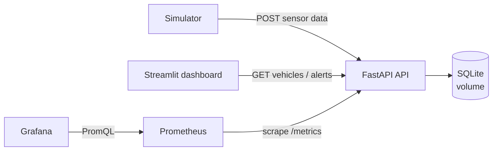
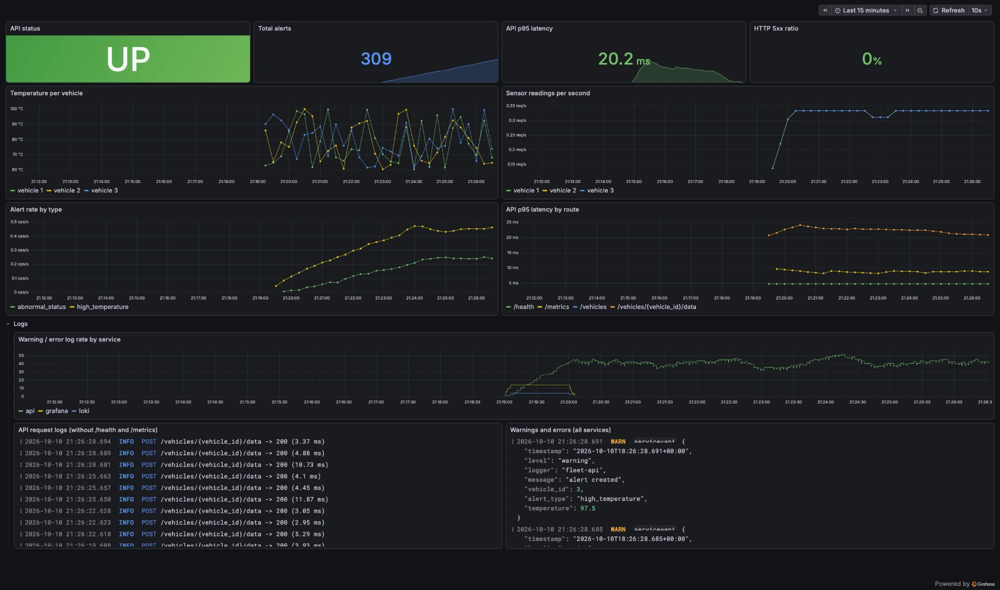

# Smart Fleet Monitoring

[](https://github.com/Ilsuyuksel133/smart-fleet/actions/workflows/ci.yml)

A small fleet-monitoring system — a FastAPI service that ingests vehicle sensor data and raises rule-based alerts, a Streamlit dashboard and a data simulator — packaged as a DevOps project: every service is containerized, the whole stack starts with one command, a GitHub Actions pipeline lints, tests, builds and smoke-tests it on every change, and Prometheus + Grafana provide metrics, dashboards and alerting.

## Architecture



| Service | Description | URL |
|---|---|---|
| `api` | FastAPI REST API, `/health` and `/metrics` | http://localhost:8000/docs |
| `dashboard` | Streamlit UI showing vehicles and alerts | http://localhost:8501 |
| `simulator` | Sends random sensor readings every few seconds | – |
| `prometheus` | Scrapes metrics, evaluates alert rules | http://localhost:9090 |
| `grafana` | Provisioned "Fleet Overview" dashboard | http://localhost:3000 |

## Quick start

Requires Docker with Compose v2.

```bash
cp .env.example .env
docker compose up -d --build
```

Grafana: user `admin`, password from `GF_SECURITY_ADMIN_PASSWORD` in `.env` (anonymous read-only access is enabled).

Verify the running stack end to end:

```bash
make smoke
```

Stop with `make down`; remove all data with `make clean` (`docker compose down -v`).

## Configuration

All configuration comes from environment variables (see `.env.example`).

| Variable | Service | Default | Description |
|---|---|---|---|
| `DATABASE_URL` | api | `sqlite:///./data/fleet.db` | SQLAlchemy database URL |
| `ALERT_TEMP_THRESHOLD` | api | `80` | Temperature (°C) above which an alert is created |
| `LOG_LEVEL` | api | `INFO` | Python log level |
| `API_URL` | dashboard, simulator | `http://localhost:8000` | API base URL |
| `INTERVAL_SECONDS` | simulator | `3` | Delay between simulated readings |
| `GF_SECURITY_ADMIN_PASSWORD` | grafana | – (required) | Grafana admin password |

## CI/CD

The pipeline in [`.github/workflows/ci.yml`](.github/workflows/ci.yml) runs on pushes and pull requests to `main`:

1. **lint-and-test** — `ruff check`, `ruff format --check`, `pytest` with coverage (report uploaded as an artifact).
2. **docker-build** — builds the `api`, `dashboard` and `simulator` images in parallel (matrix) with GitHub Actions layer cache. On `main`, images are pushed to GHCR as `ghcr.io/ilsuyuksel133/smart-fleet-<service>` with `sha-<short-sha>` and `latest` tags. Pull requests only build.
3. **smoke-test** — starts the full stack with Docker Compose, runs [`scripts/smoke_test.sh`](scripts/smoke_test.sh), prints logs on failure and always tears the stack down.

Older runs on the same branch are cancelled automatically, and the workflow runs with least-privilege `GITHUB_TOKEN` permissions.

## Monitoring

<!-- Add a screenshot of the Grafana dashboard as docs/images/grafana.png and uncomment:

-->

### Metrics (`GET /metrics`)

| Metric | Type | Labels | Description |
|---|---|---|---|
| `fleet_sensor_readings_total` | Counter | `vehicle_id` | Sensor readings received |
| `fleet_alerts_total` | Counter | `type` (`high_temperature`, `abnormal_status`) | Alerts created |
| `fleet_vehicle_temperature_celsius` | Gauge | `vehicle_id` | Last reported temperature |
| `http_requests_total` | Counter | `method`, `path`, `status` | HTTP requests |
| `http_request_duration_seconds` | Histogram | `method`, `path` | HTTP request latency |

HTTP metrics use the route template (`/vehicles/{vehicle_id}/data`) as the `path` label rather than the raw URL, which keeps label cardinality bounded.

### Alert rules

Defined in [`monitoring/prometheus/alert_rules.yml`](monitoring/prometheus/alert_rules.yml) and visible on Prometheus' **Alerts** page. Response steps are in the [runbook](docs/RUNBOOK.md).

| Alert | Condition | For | Severity |
|---|---|---|---|
| `FleetApiDown` | `up{job="fleet-api"} == 0` | 30s | critical |
| `VehicleOverheating` | `fleet_vehicle_temperature_celsius > 90` | 30s | warning |
| `HighAlertRate` | `sum(rate(fleet_alerts_total[5m])) > 0.5` | 1m | warning |

### Grafana

The Prometheus datasource and the **Fleet Overview** dashboard are provisioned from [`monitoring/grafana`](monitoring/grafana), so no manual setup is needed. Panels: API up/down, total alerts, p95 latency, 5xx ratio, temperature per vehicle, sensor readings per second, alert rate by type and p95 latency by route.

## API endpoints

| Method | Endpoint | Description |
|---|---|---|
| POST | `/vehicles` | Add a new vehicle |
| POST | `/vehicles/{id}/data` | Send sensor data (404 if the vehicle does not exist) |
| GET | `/vehicles` | List all vehicles with their latest status |
| GET | `/vehicles/{id}/status` | Get sensor logs of a vehicle |
| GET | `/alerts` | List all alerts |
| GET | `/health` | Health check including a database query (503 if the DB is unreachable) |
| GET | `/metrics` | Prometheus metrics |

Alert logic: temperature above `ALERT_TEMP_THRESHOLD` creates a high-temperature alert; a status other than `OK` creates an abnormal-status alert.

## Local development

```bash
python3.11 -m venv .venv
source .venv/bin/activate
make install   # pip install -r requirements-dev.txt
make lint      # ruff check + format check
make format    # auto-fix and format
make test      # pytest --cov=api
```

Other targets: `make up`, `make down`, `make logs`, `make smoke`, `make clean`.

## Project structure

```
api/          FastAPI service (main.py, database.py, models.py, metrics.py) + Dockerfile
dashboard/    Streamlit dashboard + Dockerfile
simulator/    Sensor data simulator + Dockerfile
tests/        pytest suite (isolated SQLite DB per test)
monitoring/   Prometheus config and alert rules, Grafana provisioning and dashboard
scripts/      smoke_test.sh
docs/         Operational runbook
```

## Next steps

- Alertmanager with Slack / e-mail notifications
- Move from SQLite to PostgreSQL (`postgres` service in Compose)
- Deploy the stack to AWS EC2 with Terraform
- Centralized logs with Loki + Promtail and a log panel in Grafana
