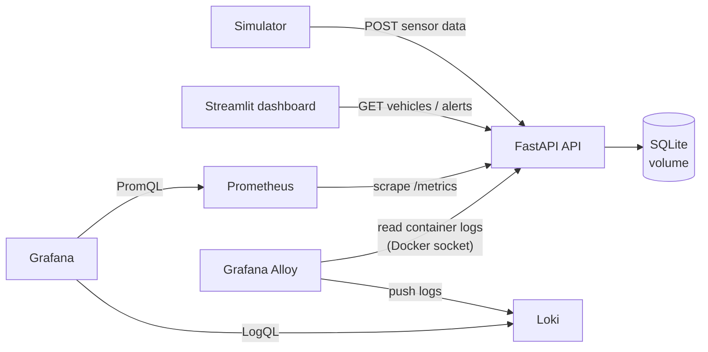
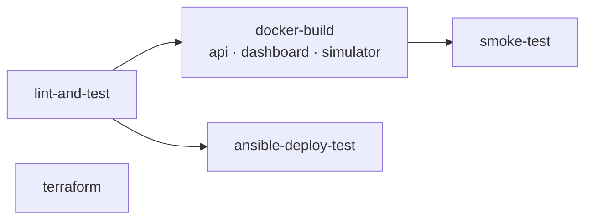
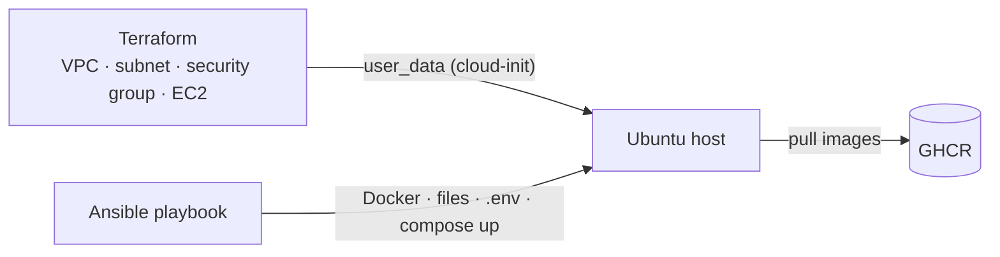

# Smart Fleet Monitoring

[](https://github.com/Ilsuyuksel133/smart-fleet/actions/workflows/ci.yml)

A small fleet-monitoring system — a FastAPI service that ingests vehicle sensor data and raises rule-based alerts, a Streamlit dashboard and a data simulator — packaged as a DevOps project: every service is containerized, the whole stack starts with one command, a GitHub Actions pipeline lints, tests, builds, deploys and smoke-tests it on every change, Prometheus, Loki and Grafana provide metrics, logs, dashboards and alerting, and the deployment is automated with Ansible and described as infrastructure as code with Terraform.

## Architecture



| Service | Description | URL |
|---|---|---|
| `api` | FastAPI REST API, `/health` and `/metrics`, JSON logs | http://localhost:8000/docs |
| `dashboard` | Streamlit UI showing vehicles and alerts | http://localhost:8501 |
| `simulator` | Sends random sensor readings every few seconds | – |
| `prometheus` | Scrapes metrics, evaluates alert rules | http://localhost:9090 |
| `loki` | Stores logs (7-day retention) | http://localhost:3100 |
| `alloy` | Collects container logs and ships them to Loki | http://localhost:12345 |
| `grafana` | Provisioned "Fleet Overview" dashboard (metrics + logs) | http://localhost:3000 |

## Quick start

Requires Docker with Compose v2.

```bash
cp .env.example .env
docker compose up -d --build
```

Grafana: user `admin`, password from `GF_SECURITY_ADMIN_PASSWORD` in `.env` (anonymous read-only access is enabled).

Verify the running stack end to end (API, alerts, metrics and log ingestion):

```bash
make smoke
```

Stop with `make down`; remove all data with `make clean` (`docker compose down -v`).

## Configuration

All configuration comes from environment variables (see `.env.example`).

| Variable | Service | Default | Description |
|---|---|---|---|
| `DATABASE_URL` | api | `sqlite:///./data/fleet.db` | SQLAlchemy database URL |
| `ALERT_TEMP_THRESHOLD` | api | `80` | Temperature (°C) above which an alert is created |
| `LOG_LEVEL` | api, simulator | `INFO` | Python log level |
| `API_URL` | dashboard, simulator | `http://localhost:8000` | API base URL |
| `INTERVAL_SECONDS` | simulator | `3` | Delay between simulated readings |
| `GF_SECURITY_ADMIN_PASSWORD` | grafana | – (required) | Grafana admin password |
| `IMAGE_TAG` | api, dashboard, simulator | – (prod only) | GHCR image tag used by `docker-compose.prod.yml` |

## CI/CD

The pipeline in [`.github/workflows/ci.yml`](.github/workflows/ci.yml) runs on pushes and pull requests to `main`:



| Job | What it does |
|---|---|
| **lint-and-test** | `ruff check`, `ruff format --check`, `pytest` with coverage (report uploaded as an artifact) |
| **docker-build** | Builds the three images in parallel (matrix) with GitHub Actions layer cache. On `main` pushes them to GHCR as `ghcr.io/ilsuyuksel133/smart-fleet-<service>` with `sha-<short-sha>` and `latest` tags; pull requests only build |
| **smoke-test** | Starts the full stack with Docker Compose, runs [`scripts/smoke_test.sh`](scripts/smoke_test.sh) (health → alert → metrics → log in Loki), prints logs on failure, always tears down |
| **ansible-deploy-test** | Lints the playbook, builds this commit's images, runs the playbook against the runner (`localhost`), runs the smoke test, then runs the playbook again and fails unless it reports `changed=0` |
| **terraform** | `fmt -check`, `validate`, `tflint`, then `plan` → `apply` → output checks → `plan` (must be empty) → `destroy` against a local AWS emulator (Moto) |

Older runs on the same branch are cancelled automatically, the workflow runs with least-privilege `GITHUB_TOKEN` permissions, and all actions, tools and images are pinned.

## Monitoring


### Metrics (`GET /metrics`)

| Metric | Type | Labels | Description |
|---|---|---|---|
| `fleet_sensor_readings_total` | Counter | `vehicle_id` | Sensor readings received |
| `fleet_alerts_total` | Counter | `type` (`high_temperature`, `abnormal_status`) | Alerts created |
| `fleet_vehicle_temperature_celsius` | Gauge | `vehicle_id` | Last reported temperature |
| `http_requests_total` | Counter | `method`, `path`, `status` | HTTP requests |
| `http_request_duration_seconds` | Histogram | `method`, `path` | HTTP request latency |

HTTP metrics use the route template (`/vehicles/{vehicle_id}/data`) as the `path` label rather than the raw URL, which keeps label cardinality bounded.

### Alert rules

Defined in [`monitoring/prometheus/alert_rules.yml`](monitoring/prometheus/alert_rules.yml) and visible on Prometheus' **Alerts** page. Response steps are in the [runbook](docs/RUNBOOK.md).

| Alert | Condition | For | Severity |
|---|---|---|---|
| `FleetApiDown` | `up{job="fleet-api"} == 0` | 30s | critical |
| `VehicleOverheating` | `fleet_vehicle_temperature_celsius > 90` | 30s | warning |
| `HighAlertRate` | `sum(rate(fleet_alerts_total[5m])) > 0.5` | 1m | warning |

### Grafana

The Prometheus and Loki datasources and the **Fleet Overview** dashboard are provisioned from [`monitoring/grafana`](monitoring/grafana), so no manual setup is needed. Panels: API up/down, total alerts, p95 latency, 5xx ratio, temperature per vehicle, sensor readings per second, alert rate by type, p95 latency by route, warning/error log rate by service, API request logs and warning/error logs.

## Logging

The API and the simulator write **one JSON object per line** to stdout, using a small formatter on top of Python's `logging` module ([`api/logging_config.py`](api/logging_config.py)):

```json
{"timestamp": "2026-10-10T17:39:23.019+00:00", "level": "warning", "logger": "fleet-api", "message": "alert created", "vehicle_id": 1, "alert_type": "high_temperature", "temperature": 90.2}
```

- Every HTTP request is logged once with `method`, `path` (route template), `status` and `duration_ms`.
- Every alert is logged at `warning` level with `vehicle_id`, `alert_type` and `temperature`.

**Collection:** [Grafana Alloy](monitoring/alloy/config.alloy) discovers the containers of this Compose project through the Docker socket (mounted read-only), extracts the log level and pushes the logs to [Loki](monitoring/loki/loki-config.yml) (filesystem storage, 7-day retention). Promtail is not used because it reached end of life in March 2026.

**Label strategy:** only two low-cardinality labels are indexed — `service` (Compose service name) and `level` (normalized to `info`, `warning`, `error`). High-cardinality fields such as `vehicle_id` or `path` are *not* labels; they are parsed at query time with `| json`.

**Log rotation:** every container uses the `json-file` driver with `max-size: 10m` and `max-file: 3`, so logs cannot fill the disk.

Example LogQL queries (Grafana → Explore → Loki):

```logql
# Failed API requests
{service="api"} | json | status >= 400

# Alerts for one vehicle
{service="api"} | json | message="alert created" | vehicle_id="3"

# Slow requests
{service="api"} | json | message="request" | duration_ms > 100

# Warning/error rate per service
sum by (service) (count_over_time({level=~"warning|error"}[1m]))
```

## Deployment (Ansible)

[`deploy/ansible`](deploy/ansible) contains a playbook that turns an Ubuntu server into a running smart-fleet host:



The `smart_fleet` role:

1. checks the required variables (an immutable image tag — `latest` is rejected — and the Grafana password),
2. installs Docker Engine and the Compose plugin from Docker's apt repository **only if they are missing**,
3. creates `/opt/smart-fleet`, copies `docker-compose.yml`, [`docker-compose.prod.yml`](docker-compose.prod.yml) and `monitoring/`, and renders `.env` from a template (mode `0600`),
4. starts the stack with the GHCR images (`community.docker.docker_compose_v2`),
5. waits until `/health` returns 200.

```bash
cd deploy/ansible
pip install -r requirements.txt
cp inventory.example.ini inventory.ini   # add your host
ansible-playbook -i inventory.ini site.yml \
  -e smart_fleet_image_tag=sha-1a2b3c4 \
  -e smart_fleet_grafana_admin_password='<password>'
```

**Idempotency:** running the playbook a second time changes nothing. CI verifies this on every run by executing the playbook twice against the GitHub Actions runner and requiring `changed=0` on the second run.

*Tested on:* the GitHub Actions Ubuntu runner and macOS (Docker Desktop), both against `localhost`. On both, Docker was already installed, so the Docker installation tasks were skipped; they are linted but have not been executed on a fresh server.

## Infrastructure as Code (Terraform)

[`infra/terraform/aws`](infra/terraform/aws) describes the AWS infrastructure for a single-instance deployment: VPC, public subnet, internet gateway and route table, a security group that only opens ports 22/8000/3000 to an explicit list of CIDRs (`0.0.0.0/0` is rejected), and a `t3.micro` Ubuntu 24.04 instance (IMDSv2, encrypted volume) whose cloud-init runs the Ansible playbook above on first boot.

> **This module has not been applied to a real AWS account.** It is tested in CI against [Moto](https://github.com/getmoto/moto), an open-source local AWS emulator: `plan` → `apply` → output checks → empty re-`plan` → `destroy`. Moto only simulates the AWS API — no VM is started and cloud-init never runs. See the [module README](infra/terraform/aws/README.md) for details.

## API endpoints

| Method | Endpoint | Description |
|---|---|---|
| POST | `/vehicles` | Add a new vehicle |
| POST | `/vehicles/{id}/data` | Send sensor data (404 if the vehicle does not exist) |
| GET | `/vehicles` | List all vehicles with their latest status |
| GET | `/vehicles/{id}/status` | Get sensor logs of a vehicle |
| GET | `/alerts` | List all alerts |
| GET | `/health` | Health check including a database query (503 if the DB is unreachable) |
| GET | `/metrics` | Prometheus metrics |

Alert logic: temperature above `ALERT_TEMP_THRESHOLD` creates a high-temperature alert; a status other than `OK` creates an abnormal-status alert.

## Local development

```bash
python3.11 -m venv .venv
source .venv/bin/activate
make install   # pip install -r requirements-dev.txt
make lint      # ruff check + format check
make format    # auto-fix and format
make test      # pytest --cov=api
```

Other targets: `make up`, `make down`, `make logs`, `make smoke`, `make clean`.

## Project structure

```
api/              FastAPI service (main.py, database.py, models.py, metrics.py, logging_config.py) + Dockerfile
dashboard/        Streamlit dashboard + Dockerfile
simulator/        Sensor data simulator + Dockerfile
tests/            pytest suite (isolated SQLite DB per test)
monitoring/       Prometheus rules, Loki and Alloy config, Grafana provisioning and dashboard
scripts/          smoke_test.sh
deploy/ansible/   Ansible playbook and smart_fleet role
infra/terraform/  Terraform AWS module (tested against Moto)
docs/             Operational runbook, screenshots
```

## Next steps

- Alertmanager with Slack / e-mail notifications
- Move from SQLite to PostgreSQL (`postgres` service in Compose)
- Apply the Terraform module to a real AWS account with a remote state backend
- Helm chart and a Kubernetes (kind) deployment test in CI
