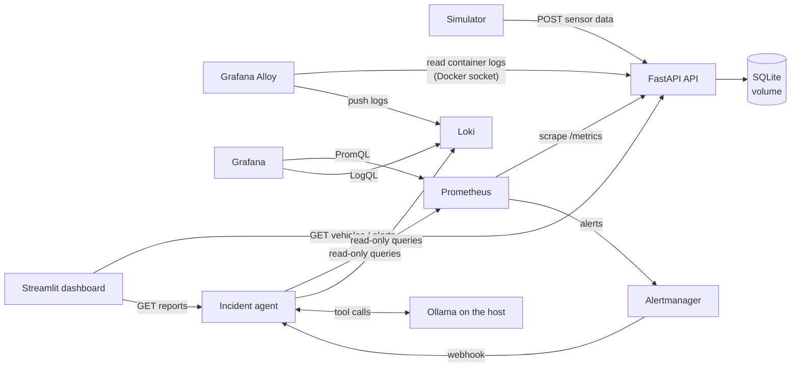
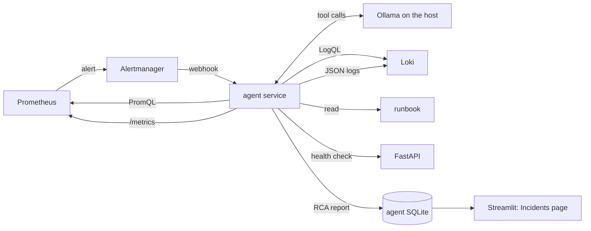
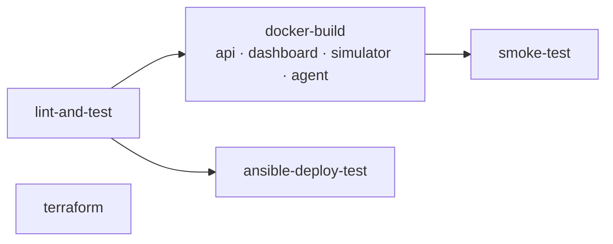
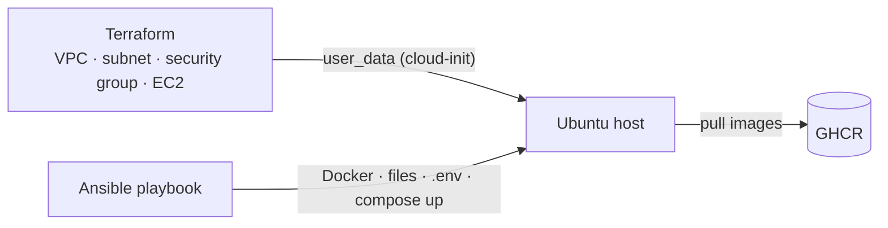

# Smart Fleet Monitoring

[](https://github.com/Ilsuyuksel133/smart-fleet/actions/workflows/ci.yml)

A small fleet-monitoring system — a FastAPI service that ingests vehicle sensor data and raises rule-based alerts, a Streamlit dashboard and a data simulator — packaged as a DevOps project: every service is containerized, the whole stack starts with one command, a GitHub Actions pipeline lints, tests, builds, deploys and smoke-tests it on every change, Prometheus, Loki and Grafana provide metrics, logs, dashboards and alerting, and the deployment is automated with Ansible and described as infrastructure as code with Terraform. An **AI incident agent** investigates firing alerts with a local LLM and read-only tools and writes a root cause report for a human to act on.

## Architecture



| Service | Description | URL |
|---|---|---|
| `api` | FastAPI REST API, `/health` and `/metrics`, JSON logs | http://localhost:8000/docs |
| `dashboard` | Streamlit UI: vehicles and alerts, plus an **Incidents** page with the agent's reports | http://localhost:8501 |
| `simulator` | Sends random sensor readings every few seconds | – |
| `prometheus` | Scrapes metrics, evaluates alert rules | http://localhost:9090 |
| `loki` | Stores logs (7-day retention) | http://localhost:3100 |
| `alloy` | Collects container logs and ships them to Loki | http://localhost:12345 |
| `grafana` | Provisioned "Fleet Overview" dashboard (metrics, logs, agent) | http://localhost:3000 |
| `alertmanager` | Routes firing alerts to the incident agent | http://localhost:9093 |
| `agent` | AI incident agent: investigates alerts, stores RCA reports | http://localhost:8100/docs |

## Quick start

Requires Docker with Compose v2.

```bash
cp .env.example .env
docker compose up -d --build
```

Grafana: user `admin`, password from `GF_SECURITY_ADMIN_PASSWORD` in `.env` (anonymous read-only access is enabled).

The incident agent uses a local model through [Ollama](https://ollama.com) running on the host:

```bash
brew install ollama && brew services start ollama
ollama pull qwen3:8b
```

Without Ollama, set `LLM_PROVIDER=fake` in `.env`: the agent then writes scripted demo reports. With `ollama` but no Ollama running, the agent stays up and its reports end with `stop_reason: llm_error`.

Verify the running stack end to end (API, alerts, metrics, log ingestion and an agent investigation):

```bash
make smoke
```

Stop with `make down`; remove all data with `make clean` (`docker compose down -v`).

## Configuration

All configuration comes from environment variables (see `.env.example`).

| Variable | Service | Default | Description |
|---|---|---|---|
| `DATABASE_URL` | api | `sqlite:///./data/fleet.db` | SQLAlchemy database URL |
| `ALERT_TEMP_THRESHOLD` | api | `80` | Temperature (°C) above which an alert is created |
| `LOG_LEVEL` | api, simulator | `INFO` | Python log level |
| `API_URL` | dashboard, simulator | `http://localhost:8000` | API base URL |
| `INTERVAL_SECONDS` | simulator | `3` | Delay between simulated readings |
| `GF_SECURITY_ADMIN_PASSWORD` | grafana | – (required) | Grafana admin password |
| `IMAGE_TAG` | api, dashboard, simulator, agent | – (prod only) | GHCR image tag used by `docker-compose.prod.yml` |
| `SIMULATOR_MODE` | simulator | `random` | `random`, or the evaluation fault modes `calm`, `overheat`, `storm` |
| `LLM_PROVIDER` | agent | `ollama` | `ollama` (local model) or `fake` (scripted, used in CI) |
| `OLLAMA_URL` | agent | `http://host.docker.internal:11434` | Ollama on the host |
| `OLLAMA_MODEL` | agent | `qwen3:8b` | Model used by the agent |

The agent's other settings (step and time limits, tool limits, cooldown, token cap) are defined in [`agent/config.py`](agent/config.py). Each can be overridden with an environment variable of the same name.

## AI Incident Agent

When a Prometheus alert fires, an **agent** investigates it on its own:
1. It decides which metrics, logs and runbook sections to look at.
2. It queries them through read-only tools.
3. It writes a structured root cause analysis (RCA) report.

A human reads the report and decides what to do; the agent never changes the system.



### The agent loop

[`agent/loop.py`](agent/loop.py) is a plain-Python implementation of tool calling, without an agent framework:

1. Start the conversation with a system prompt and the alert (name and labels).
2. Call the LLM and offer it the tool definitions.
3. If it asks for tools, run them, add the results (linked by `tool_call_id`) to the conversation and go back to step 2.
4. If it answers without tools, parse the answer into an `RCAReport` ([`agent/report.py`](agent/report.py)).

The LLM decides *which* data to look at; the loop decides *how much* it may do. Every investigation ends with a report, never with an exception:

| Guard rail | Behaviour |
|---|---|
| Step limit | At most `AGENT_MAX_STEPS` (8) LLM calls; the `for` loop itself is the limit |
| Time limit | At most `AGENT_MAX_SECONDS` (300 s) per investigation |
| Duplicate calls | The same tool with the same arguments is not run again; the model is told to move on |
| No evidence | An answer given before any tool ran is sent back once; if the model insists, confidence is capped at `low` |
| Invalid JSON | One retry without tools, constrained to the report's JSON schema (Ollama structured output) |
| Tool errors | Timeouts, connection errors and invalid queries return a readable `ERROR: ...` to the model instead of raising |
| LLM errors | A timed-out call is retried once; if the model stays unreachable, the loop writes the report |

When the loop has to stop the model, it writes the report itself: `unknown`, `low` confidence, a `stop_reason` (`max_steps`, `timeout`, `invalid_output`, `llm_error`) and all tool results collected so far as evidence.

**Report fields:**
- `summary`
- `root_cause_category`: `service_down`, `sensor_anomaly`, `alert_storm` or `unknown`
- `root_cause_explanation`
- `evidence[]`: tool, query and finding
- `confidence`: `low`, `medium` or `high`
- `suggested_actions`
- `steps_used`, `duration_seconds`, `stop_reason`

The fixed category list makes the evaluation deterministic.

### Tools

All tools in [`agent/tools.py`](agent/tools.py) are **read-only** (HTTP GET or reading the runbook). Each has a timeout and short, summarized output, so the small local model's context window is not flooded.

| Tool | What it returns | Limits |
|---|---|---|
| `query_prometheus(promql, minutes)` | min / max / last value per series | 1–60 min, max 10 series |
| `query_loki(logql, minutes, limit)` | newest matching log lines (metric queries are summarized) | 1–60 min, max 50 lines |
| `get_runbook(alert_name)` | the matching `## <Alert>` section of [`docs/RUNBOOK.md`](docs/RUNBOOK.md) | runbook only |
| `get_service_health()` | API `/health` and Prometheus `up` per target | — |

### Safety decisions

- **No actions.** No tool can restart a container, write a file or run a command. Suggested actions are text for a human, who decides.
- **Bounded work.** The step limit, time limit, tool timeouts and output truncation keep every investigation short and predictable.
- **Alert storm protection.**
  - Alertmanager groups by alert name and repeats a firing alert only every 4 h.
  - The agent never queues the same alert twice.
  - It skips an alert that was investigated in the last 15 min (manual requests excepted).
- **One investigation at a time.** A queue with a single worker thread: a local model serves one request efficiently, and the webhook returns `202` immediately.
- **Separate storage.** Reports live in the agent's own SQLite file and Docker volume, so the agent keeps working when the fleet API or its database is the problem.

### Trigger, storage and UI

- **Trigger:** Alertmanager ([`monitoring/alertmanager/alertmanager.yml`](monitoring/alertmanager/alertmanager.yml)) posts firing alerts to `POST /webhook/alertmanager`. `POST /investigate` starts an investigation by hand.
- **Reports:** `GET /reports` and `GET /reports/{id}`. The **Incidents** page in Streamlit lists them and shows the evidence and suggested actions.
- **Agent metrics:**
  - `agent_investigations_total{category}`
  - `agent_investigation_duration_seconds`
  - `agent_tool_calls_total{tool}`
  - `agent_steps_per_investigation`

  Grafana shows them in the provisioned "Incident agent" row, together with the agent's step logs from Loki.

### Model choice

The default model is **`qwen3:8b`** in Ollama, with "thinking" turned off:
- **Tool calling:** it is listed with tool calling support in the Ollama library.
- **Fits the hardware:** the Q4 download is 5.2 GB, which leaves room for the rest of the stack on a 16 GB Apple Silicon Mac.
- **Speed:** with thinking off, an investigation takes about 30–90 s.
- **GPU access:** Ollama runs on the host, not in Docker, because Docker on macOS cannot use the GPU (Metal).

The agent reaches it at `http://host.docker.internal:11434`. Model and URL are environment variables (`OLLAMA_MODEL`, `OLLAMA_URL`). No other model has been evaluated yet.

`LLM_PROVIDER=fake` replaces the model with a scripted provider. CI uses it to test the whole path (webhook → queue → loop → tool call → report) without a model.

### Evaluation

[`eval/`](eval/README.md) injects known faults into the running stack, asks the agent to investigate and compares the root cause category. Each run starts from a clean system:
- stop the API
- make one vehicle overheat
- make every vehicle report errors
- a false alarm on a healthy system

| Scenario | Expected | Run A | Run B | Run C |
|---|---|---|---|---|
| API container stopped | service_down | 2/3 | 2/3 | 3/3 |
| One vehicle at 95–100 °C | sensor_anomaly | 3/3 | 2/3 | 0/3 |
| Every vehicle reports ERROR | alert_storm | 3/3 | 3/3 | 3/3 |
| False alarm, healthy system | unknown / low confidence | 3/3 | 2/3 | 3/3 |
| **Total** | | **11/12** | **9/12** | **9/12** |

**29 of 36 runs correct (81%)** with `qwen3:8b` on an Apple M2. The code changed slightly between the runs; the per-run results and an analysis of every failure are in [`eval/README.md`](eval/README.md).

```bash
python -m eval.run_eval --runs 3      # needs the stack running with LLM_PROVIDER=ollama
python -m agent.cli HighAlertRate     # a single investigation, printed as JSON (inside the agent container)
```

### Limitations

- **A small model makes reasoning errors.** The most frequent one (4 of 7 failures): it queries a label that does not exist, gets "no data" and treats that as evidence.
- **Small, clear-cut evaluation.** 3 runs per scenario, one fault at a time, and categories close to the alert names. Real incidents are messier, and the accuracy is indicative only.
- **Four categories only.** Anything else is `unknown`.
- **Slow.** A local model needs tens of seconds per step, and investigations run one after another.
- **No authentication.** The agent's endpoints have none; they are meant for the internal Docker network.
- **CI does not test reasoning.** The fake provider only exercises the plumbing; the model's quality is measured by the local evaluation.

## CI/CD

The pipeline in [`.github/workflows/ci.yml`](.github/workflows/ci.yml) runs on pushes and pull requests to `main`:



| Job | What it does |
|---|---|
| **lint-and-test** | `ruff check`, `ruff format --check`, `pytest` with coverage of `api`, `agent` and `eval` (report uploaded as an artifact) |
| **docker-build** | Builds the four images in parallel (matrix) with GitHub Actions layer cache. On `main` pushes them to GHCR as `ghcr.io/ilsuyuksel133/smart-fleet-<service>` with `sha-<short-sha>` and `latest` tags; pull requests only build |
| **smoke-test** | Starts the full stack with Docker Compose, runs [`scripts/smoke_test.sh`](scripts/smoke_test.sh) (health → alert → metrics → log in Loki → agent: webhook alert → stored RCA report, with `LLM_PROVIDER=fake`), prints logs on failure, always tears down |
| **ansible-deploy-test** | Lints the playbook, builds this commit's images, runs the playbook against the runner (`localhost`), runs the smoke test, then runs the playbook again and fails unless it reports `changed=0` |
| **terraform** | `fmt -check`, `validate`, `tflint`, then `plan` → `apply` → output checks → `plan` (must be empty) → `destroy` against a local AWS emulator (Moto) |

Older runs on the same branch are cancelled automatically, the workflow runs with least-privilege `GITHUB_TOKEN` permissions, and all actions, tools and images are pinned.

## Monitoring


### Metrics (`GET /metrics`)

| Metric | Type | Labels | Description |
|---|---|---|---|
| `fleet_sensor_readings_total` | Counter | `vehicle_id` | Sensor readings received |
| `fleet_alerts_total` | Counter | `type` (`high_temperature`, `abnormal_status`) | Alerts created |
| `fleet_vehicle_temperature_celsius` | Gauge | `vehicle_id` | Last reported temperature |
| `http_requests_total` | Counter | `method`, `path`, `status` | HTTP requests |
| `http_request_duration_seconds` | Histogram | `method`, `path` | HTTP request latency |

HTTP metrics use the route template (`/vehicles/{vehicle_id}/data`) as the `path` label rather than the raw URL, which keeps label cardinality bounded.

### Alert rules

Defined in [`monitoring/prometheus/alert_rules.yml`](monitoring/prometheus/alert_rules.yml) and visible on Prometheus' **Alerts** page. Response steps are in the [runbook](docs/RUNBOOK.md).

| Alert | Condition | For | Severity |
|---|---|---|---|
| `FleetApiDown` | `up{job="fleet-api"} == 0` | 30s | critical |
| `VehicleOverheating` | `fleet_vehicle_temperature_celsius > 90` | 30s | warning |
| `HighAlertRate` | `sum(rate(fleet_alerts_total[5m])) > 0.5` | 1m | warning |

### Grafana

The Prometheus and Loki datasources and the **Fleet Overview** dashboard are provisioned from [`monitoring/grafana`](monitoring/grafana), so no manual setup is needed. Panels: API up/down, total alerts, p95 latency, 5xx ratio, temperature per vehicle, sensor readings per second, alert rate by type, p95 latency by route, warning/error log rate by service, API request logs, warning/error logs, and an "Incident agent" row (investigations by root cause, duration, steps, tool calls, investigation log).

## Logging

The API, the simulator and the agent write **one JSON object per line** to stdout, using a small formatter on top of Python's `logging` module ([`api/logging_config.py`](api/logging_config.py)):

```json
{"timestamp": "2026-10-10T17:39:23.019+00:00", "level": "warning", "logger": "fleet-api", "message": "alert created", "vehicle_id": 1, "alert_type": "high_temperature", "temperature": 90.2}
```

- Every HTTP request is logged once with `method`, `path` (route template), `status` and `duration_ms`.
- Every alert is logged at `warning` level with `vehicle_id`, `alert_type` and `temperature`.

**Collection:** [Grafana Alloy](monitoring/alloy/config.alloy) discovers the containers of this Compose project through the Docker socket (mounted read-only), extracts the log level and pushes the logs to [Loki](monitoring/loki/loki-config.yml) (filesystem storage, 7-day retention). Promtail is not used because it reached end of life in March 2026.

**Label strategy:** only two low-cardinality labels are indexed — `service` (Compose service name) and `level` (normalized to `info`, `warning`, `error`). High-cardinality fields such as `vehicle_id` or `path` are *not* labels; they are parsed at query time with `| json`.

**Log rotation:** every container uses the `json-file` driver with `max-size: 10m` and `max-file: 3`, so logs cannot fill the disk.

Example LogQL queries (Grafana → Explore → Loki):

```logql
# Failed API requests
{service="api"} | json | status >= 400

# Alerts for one vehicle
{service="api"} | json | message="alert created" | vehicle_id="3"

# Slow requests
{service="api"} | json | message="request" | duration_ms > 100

# Warning/error rate per service
sum by (service) (count_over_time({level=~"warning|error"}[1m]))
```

## Deployment (Ansible)

[`deploy/ansible`](deploy/ansible) contains a playbook that turns an Ubuntu server into a running smart-fleet host:



The `smart_fleet` role:

1. checks the required variables (an immutable image tag — `latest` is rejected — and the Grafana password),
2. installs Docker Engine and the Compose plugin from Docker's apt repository **only if they are missing**,
3. creates `/opt/smart-fleet`, copies `docker-compose.yml`, [`docker-compose.prod.yml`](docker-compose.prod.yml) and `monitoring/`, and renders `.env` from a template (mode `0600`),
4. starts the stack with the GHCR images (`community.docker.docker_compose_v2`),
5. waits until `/health` returns 200.

```bash
cd deploy/ansible
pip install -r requirements.txt
cp inventory.example.ini inventory.ini   # add your host
ansible-playbook -i inventory.ini site.yml \
  -e smart_fleet_image_tag=sha-1a2b3c4 \
  -e smart_fleet_grafana_admin_password='<password>'
```

**Idempotency:** running the playbook a second time changes nothing. CI verifies this on every run by executing the playbook twice against the GitHub Actions runner and requiring `changed=0` on the second run.

*Tested on:* the GitHub Actions Ubuntu runner and macOS (Docker Desktop), both against `localhost`. On both, Docker was already installed, so the Docker installation tasks were skipped; they are linted but have not been executed on a fresh server.

## Infrastructure as Code (Terraform)

[`infra/terraform/aws`](infra/terraform/aws) describes the AWS infrastructure for a single-instance deployment: VPC, public subnet, internet gateway and route table, a security group that only opens ports 22/8000/3000 to an explicit list of CIDRs (`0.0.0.0/0` is rejected), and a `t3.micro` Ubuntu 24.04 instance (IMDSv2, encrypted volume) whose cloud-init runs the Ansible playbook above on first boot.

> **This module has not been applied to a real AWS account.** It is tested in CI against [Moto](https://github.com/getmoto/moto), an open-source local AWS emulator: `plan` → `apply` → output checks → empty re-`plan` → `destroy`. Moto only simulates the AWS API — no VM is started and cloud-init never runs. See the [module README](infra/terraform/aws/README.md) for details.

## API endpoints

| Method | Endpoint | Description |
|---|---|---|
| POST | `/vehicles` | Add a new vehicle |
| POST | `/vehicles/{id}/data` | Send sensor data (404 if the vehicle does not exist) |
| GET | `/vehicles` | List all vehicles with their latest status |
| GET | `/vehicles/{id}/status` | Get sensor logs of a vehicle |
| GET | `/alerts` | List all alerts |
| GET | `/health` | Health check including a database query (503 if the DB is unreachable) |
| GET | `/metrics` | Prometheus metrics |

Alert logic: temperature above `ALERT_TEMP_THRESHOLD` creates a high-temperature alert; a status other than `OK` creates an abnormal-status alert.

Incident agent (port 8100):

| Method | Endpoint | Description |
|---|---|---|
| POST | `/webhook/alertmanager` | Alertmanager webhook; queues one investigation per firing alert name (`202`) |
| POST | `/investigate` | Start an investigation manually: `{"alert_name": "...", "labels": {...}}` (`202`, `409` if already running) |
| GET | `/reports` | Investigation history (newest first) |
| GET | `/reports/{id}` | Full RCA report with evidence and suggested actions |
| GET | `/health` | Liveness (does not contact the LLM) and the configured provider/model |
| GET | `/metrics` | Prometheus metrics of the agent |

## Local development

```bash
python3.11 -m venv .venv
source .venv/bin/activate
make install   # pip install -r requirements-dev.txt
make lint      # ruff check + format check
make format    # auto-fix and format
make test      # pytest with coverage of api, agent and eval
```

Other targets: `make up`, `make down`, `make logs`, `make smoke`, `make clean`.

## Project structure

```
api/              FastAPI service (main.py, database.py, models.py, metrics.py, logging_config.py) + Dockerfile
dashboard/        Streamlit dashboard (+ pages/1_Incidents.py) + Dockerfile
simulator/        Sensor data simulator + Dockerfile
agent/            AI incident agent: config, LLM providers, tools, loop, report, queue, storage + Dockerfile
eval/             Fault-injection evaluation of the agent: scenarios, harness, results
tests/            pytest suite (isolated SQLite DB per test, mocked HTTP, scripted LLM)
monitoring/       Prometheus rules, Alertmanager, Loki and Alloy config, Grafana provisioning and dashboard
scripts/          smoke_test.sh
deploy/ansible/   Ansible playbook and smart_fleet role
infra/terraform/  Terraform AWS module (tested against Moto)
docs/             Operational runbook, screenshots
```

## Next steps

- Agent: a "no data" hint in the Prometheus tool (the most frequent reasoning error) and an evaluation of other models
- Agent: authentication for its endpoints and an MCP server exposing the same read-only tools
- Alertmanager notifications (Slack / e-mail) in addition to the agent webhook
- Move from SQLite to PostgreSQL (`postgres` service in Compose)
- Apply the Terraform module to a real AWS account with a remote state backend
- Helm chart and a Kubernetes (kind) deployment test in CI
